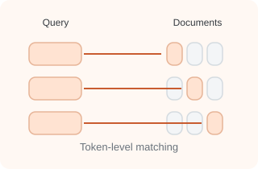
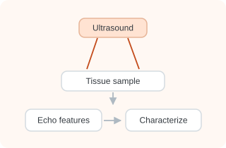
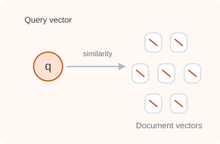
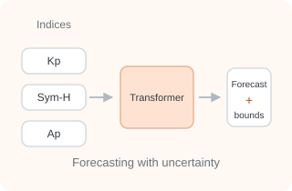
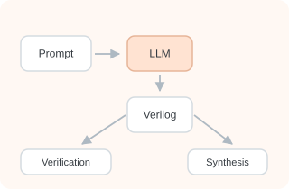
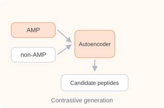
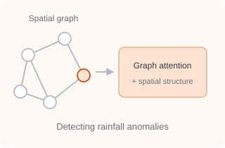
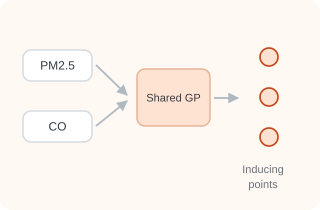
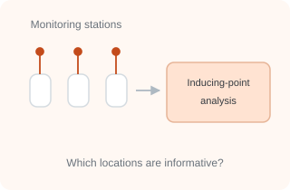
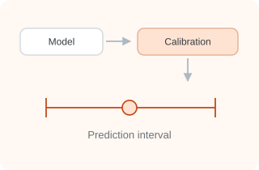

Papers, preprints, and interactive research, with a short introduction to each project.

## 2026 {#year-2026}

::: {.pub-card #retrieval-multivectors}
<figure class="pub-visual">
  
  <figcaption>Concept illustration</figcaption>
</figure>

::: {.pub-info}
### [Retrieval Needs Multivectors: An Exponential Separation](https://arxiv.org/abs/2608.21494) {.pub-title .unlisted}

::: {.pub-authors}
**Mihir Agarwal**, Viraj Agrawal, Sabyasachi Basu, Ankit Garg, Kirankumar Shiragur
:::

::: {.pub-venue}
arXiv preprint · August 2026
:::

::: {.pub-summary}
We study retrieval problems where multi-vector representations are fundamentally more expressive than single-vector embeddings. We prove an exponential separation for exact ranking and introduce ANDOR, a benchmark where multi-vector models retain a substantial advantage even after task-specific fine-tuning.
:::

::: {.pub-links}
[Paper](https://arxiv.org/abs/2608.21494){.pub-link-btn}
[PDF](https://arxiv.org/pdf/2608.21494){.pub-link-btn}
:::
:::
:::

::: {.pub-card #ultrasound-echo-statistics}
<figure class="pub-visual">
  
  <figcaption>Concept illustration</figcaption>
</figure>

::: {.pub-info}
### [Ultrasound echo envelope statistics to differentiate glioblastoma multiforme from normal brain tissue ex vivo: a proof-of-concept study](https://www.frontiersin.org/journals/acoustics/articles/10.3389/facou.2026.1882624/full) {.pub-title .unlisted}

::: {.pub-authors}
Jagruti M. Patil, **Mihir Agarwal**, Shilpa Rao, Vikas Vazhayil, Hardik J. Pandya, Anita Mahadevan, Himanshu Shekhar, Karla P. Mercado-Shekhar
:::

::: {.pub-venue}
Frontiers in Acoustics, Volume 4 · August 2026
:::

::: {.pub-summary}
We investigate whether statistical features of ultrasound echoes can distinguish glioblastoma from normal brain tissue. Combining complementary envelope-distribution models with machine-learning classifiers provides promising tissue-level discrimination in an ex vivo study, establishing a proof of concept for quantitative ultrasound characterization while motivating validation in fresh tissue and surgical settings.
:::

::: {.pub-links}
[Paper](https://www.frontiersin.org/journals/acoustics/articles/10.3389/facou.2026.1882624/full){.pub-link-btn}
:::
:::
:::

::: {.pub-card #single-vector-embeddings}
<figure class="pub-visual">
  
  <figcaption>Concept illustration</figcaption>
</figure>

::: {.pub-info}
### [On Strengths and Limitations of Single-Vector Embeddings](https://arxiv.org/abs/2603.29519) {.pub-title .unlisted}

::: {.pub-authors}
Archish S, **Mihir Agarwal**, Ankit Garg, Neeraj Kayal, Kirankumar Shiragur
:::

::: {.pub-venue}
arXiv preprint · March 2026
:::

::: {.pub-summary}
We investigate why single-vector retrieval models struggle on challenging benchmarks, showing that embedding dimensionality alone does not explain their failures. Through controlled experiments and simple mathematical models, we study domain shift, relevance mismatch, catastrophic forgetting, and the drowning in documents effect, clarifying why multi-vector representations can be more robust.
:::

::: {.pub-links}
[Paper](https://arxiv.org/abs/2603.29519){.pub-link-btn}
[PDF](https://arxiv.org/pdf/2603.29519){.pub-link-btn}
:::
:::
:::

## 2025 {#section}

::: {.pub-card #geomagnetic-storms}
<figure class="pub-visual">
  
  <figcaption>Concept illustration</figcaption>
</figure>

::: {.pub-info}
### [Uncertainty Bounds for Anomalous Geomagnetic Storm Forecasting – A Deep Learning Approach](https://ieeexplore.ieee.org/document/11171320/) {.pub-title .unlisted}

::: {.pub-authors}
**Mihir Agarwal**, Progyan Das, Shruhrid Banthia, S. B. Chakrabarty, D. Chakrabarty
:::

::: {.pub-venue}
IEEE Space, Aerospace and Defence Conference (SPACE) · 2025 [Best Paper Award]{.badge-award}
:::

::: {.pub-summary}
We develop a multitask, multivariate transformer approach to forecasting geomagnetic storm indices. Alongside the forecasts, Monte Carlo dropout provides uncertainty estimates, helping communicate confidence in predictions of anomalous space-weather conditions.
:::

::: {.pub-links}
[Paper](https://ieeexplore.ieee.org/document/11171320/){.pub-link-btn}
:::
:::
:::

::: {.pub-card #veribench}
<figure class="pub-visual">
  
  <figcaption>Concept illustration</figcaption>
</figure>

::: {.pub-info}
### [VeriBench: Benchmarking Large Language Models for Verilog Code Generation and Design Synthesis](https://ieeexplore.ieee.org/document/11044004/) {.pub-title .unlisted}

::: {.pub-authors}
**Mihir Agarwal**, Zaqi Momin, Kailash Prasad, Joycee Mekie
:::

::: {.pub-venue}
IEEE International Symposium on Circuits and Systems (ISCAS) · 2025 [Spotlight]{.badge-award}
:::

::: {.pub-summary}
We benchmark open- and closed-source language models on Verilog design generation, testbench construction, and formal-verification assertions. Beyond checking generated code, we examine synthesized hardware using FPGA and ASIC design tools, highlighting where compact open-source models perform competitively and where correctness and implementation quality remain important challenges.
:::

::: {.pub-links}
[Paper](https://ieeexplore.ieee.org/document/11044004/){.pub-link-btn}
:::
:::
:::

## 2024 {#section-1}

::: {.pub-card #peptide-space}
<figure class="pub-visual">
  
  <figcaption>Concept illustration</figcaption>
</figure>

::: {.pub-info}
### [Disentangling the Peptide Space: A Contrastive Approach with Wasserstein Autoencoders](https://openreview.net/forum?id=FKCYEbSaE1) {.pub-title .unlisted}

::: {.pub-authors}
**Mihir Agarwal**\*, Progyan Das\* [· Equal contribution]{.pub-contribution}
:::

::: {.pub-venue}
AI for New Drug Modalities workshop, NeurIPS · 2024
:::

::: {.pub-summary}
We introduce a contrastive Wasserstein autoencoder for generating candidate antimicrobial peptides. The model learns a latent space that separates antimicrobial from non-antimicrobial sequences, combining generative modeling with contrastive learning to guide candidate discovery; computational evaluation then assesses whether generated sequences exhibit the intended antimicrobial characteristics.
:::

::: {.pub-links}
[Paper](https://openreview.net/forum?id=FKCYEbSaE1){.pub-link-btn}
[PDF](https://openreview.net/pdf?id=FKCYEbSaE1){.pub-link-btn}
:::
:::
:::

## 2023 {#section-2}

::: {.pub-card #rainfall-extremes}
<figure class="pub-visual">
  
  <figcaption>Concept illustration</figcaption>
</figure>

::: {.pub-info}
### [Spatially Regularized Graph Attention Autoencoder Framework for Detecting Rainfall Extremes](https://www.climatechange.ai/papers/neurips2023/115) {.pub-title .unlisted}

::: {.pub-authors}
**Mihir Agarwal**\*, Progyan Das\*, Udit Bhatia [· Equal contribution]{.pub-contribution}
:::

::: {.pub-venue}
Tackling Climate Change with Machine Learning workshop, NeurIPS · 2023
:::

::: {.pub-summary}
We develop a spatially regularized graph attention autoencoder to identify anomalous rainfall patterns across India. By connecting locations through synchronized rainfall events and incorporating rainfall, pressure, and temperature measurements, the framework captures geographic relationships while preserving spatial coherence in climate anomaly detection.
:::

::: {.pub-links}
[Paper](https://www.climatechange.ai/papers/neurips2023/115){.pub-link-btn}
[arXiv](https://arxiv.org/abs/2411.07753){.pub-link-btn}
:::
:::
:::

::: {.pub-card #less-but-better}
<figure class="pub-visual">
  
  <figcaption>Concept illustration</figcaption>
</figure>

::: {.pub-info}
### [Less But Better: Towards better AQ Monitoring by learning Inducing Points for Multi-Task Gaussian Processes](https://openreview.net/forum?id=7juV7SKVvM) {.pub-title .unlisted}

::: {.pub-authors}
Progyan Das, **Mihir Agarwal**
:::

::: {.pub-venue}
Adaptive Experimental Design and Active Learning in the Real World workshop, NeurIPS · 2023
:::

::: {.pub-summary}
We use variational multi-output Gaussian processes to model related air pollutants while accounting for spatial and temporal structure. By learning inducing points and examining their distribution, the framework combines scalable prediction and uncertainty estimation with insights into which locations may be most informative for air-quality monitoring.
:::

::: {.pub-links}
[Paper](https://openreview.net/forum?id=7juV7SKVvM){.pub-link-btn}
:::
:::
:::

::: {.pub-card #aq-station-deployment}
<figure class="pub-visual">
  
  <figcaption>Concept illustration</figcaption>
</figure>

::: {.pub-info}
### [Focus on What’s Important! Inspecting Variational Distributions for Gaussian Processes for better AQ Station Deployment](https://openreview.net/forum?id=I1yGbIPGjx) {.pub-title .unlisted}

::: {.pub-authors}
Progyan Das\*, **Mihir Agarwal**\* [· Equal contribution]{.pub-contribution}
:::

::: {.pub-venue}
Computational Sustainability: Pitfalls and Promises from Theory to Deployment workshop, NeurIPS · 2023
:::

::: {.pub-summary}
We study what the learned inducing-point distributions of multi-task Gaussian processes reveal about air-quality monitoring. Modeling PM2.5 and carbon monoxide in Beijing, we observe that inducing points cluster around particular stations, suggesting a way to identify informative locations and support more targeted decisions about monitoring-station placement.
:::

::: {.pub-links}
[Paper](https://openreview.net/forum?id=I1yGbIPGjx){.pub-link-btn}
[PDF](https://openreview.net/pdf?id=I1yGbIPGjx){.pub-link-btn}
:::
:::
:::

::: {.pub-card #conformal-prediction}
<figure class="pub-visual">
  
  <figcaption>Concept illustration</figcaption>
</figure>

::: {.pub-info}
### [Conformal Prediction: A Visual Introduction](https://conformal-prediction.streamlit.app/) {.pub-title .unlisted}

::: {.pub-authors}
**Mihir Agarwal**, Lalit Chandra Routhu, Zeel B Patel, Nipun Batra
:::

::: {.pub-venue}
VISxAI workshop, IEEE VIS · 2023
:::

::: {.pub-summary}
We present a visual introduction to conformal prediction, explaining how predictive models can be paired with uncertainty estimates. Designed as an accessible interactive resource, the work helps readers build intuition for prediction sets and intervals and understand the role of calibration in making model outputs more informative.
:::

::: {.pub-links}
[Interactive essay](https://conformal-prediction.streamlit.app/){.pub-link-btn}
[Code](https://github.com/agarwal-mihir/Conformal-Prediction){.pub-link-btn}
:::
:::
:::
